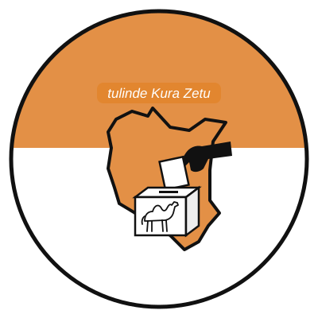

<p align="center"></p>

# The Northern IEBC

**Follow the Vote. Follow the Money.** — *tulinde Kura Zetu*

A mobile-first public-interest platform for **Garissa, Mandera, Wajir, Isiolo and Marsabit** counties:

1. **Live election results** — polling-station agents count and submit results (offline-capable), verification officers review them, and the public sees clearly labelled, source-traceable tallies.
2. **County budget transparency** — budgets, Treasury disbursements, receipts and expenditure, each with its reporting period and source.
3. **Development project tracker** — payments and physical progress reported separately, with a map.
4. **Audit & accountability** — audit findings in the wording of the source report, plus moderated citizen reports.
5. **Donations** — M-Pesa (STK Push), card (Paystack hosted checkout) and PayPal, confirmed only by the provider, with receipts and a public transparency dashboard.

> **Independence.** The platform is independently operated and is **not affiliated with or endorsed by the Independent Electoral and Boundaries Commission (IEBC)**. Monitoring figures are not official declarations. See [docs/BRANDING.md](docs/BRANDING.md) about the logo.

> **No fabricated data.** The repository ships with no election results, budgets, projects, findings or donations. Only factual reference data is seeded (the five counties and the four official portals). Everything else enters through the reviewed import workflow. A clearly-labelled `DEMO` seed exists for local development only and refuses to run in production.

## Repository layout

| Path | Contents |
| --- | --- |
| `server/` | Express 5 + TypeScript API, Mongoose models, Socket.IO, background jobs, payment adapters, tests |
| `web/` | React 18 + Vite + Tailwind PWA: public site, agent portal, admin portal, verification portal |
| `deploy/` | Nginx config, PM2 ecosystem, encrypted backup / restore / restore-test scripts, systemd timers |
| `tests/` | Playwright end-to-end smoke test; load test lives in `server/src/scripts/loadTest.ts` |
| `docs/` | Architecture, API, administrator guide, deployment, security, testing |

## Quick start (development)

Prerequisites: Node 22, a MongoDB 7 **replica set** (transactions), optionally Redis and ClamAV.

```bash
npm install
cp server/.env.example server/.env        # then generate DATA_ENCRYPTION_KEY / BLIND_INDEX_KEY
mongod --replSet rs0 --dbpath ./data &     # and once: mongosh --eval 'rs.initiate()'
npm run db:init -w server                   # create collections and indexes
npm run db:seed-reference -w server         # 5 counties + official portals
npm run db:seed-demo -w server              # OPTIONAL synthetic DEMO election for local testing
npm run dev:server                          # API on :4000
npm run dev:web                             # web on :5173 (proxies /api and /socket.io)
```

Create the first real administrator (enrols MFA on first sign-in):

```bash
ADMIN_EMAIL=you@example.org ADMIN_NAME="Your Name" ADMIN_PASSWORD='a long passphrase' npm run user:create-admin -w server
```

## Tests

```bash
npm test                      # server integration tests (real MongoDB) + web unit tests
node tests/e2e/run.mjs        # browser end-to-end smoke test against a running, demo-seeded stack
npm run test:load             # load test against a running non-production API
deploy/scripts/restore-test.sh  # backup restoration test
```

Results of the runs made while building this repository are recorded in [docs/TESTING.md](docs/TESTING.md).

## Documentation

- [Architecture & implementation status](docs/ARCHITECTURE.md)
- [API reference](docs/API.md)
- [Administrator guide](docs/ADMIN_GUIDE.md)
- [Deployment, backups & recovery](docs/DEPLOYMENT.md)
- [Security](docs/SECURITY.md)
- [Testing](docs/TESTING.md)
